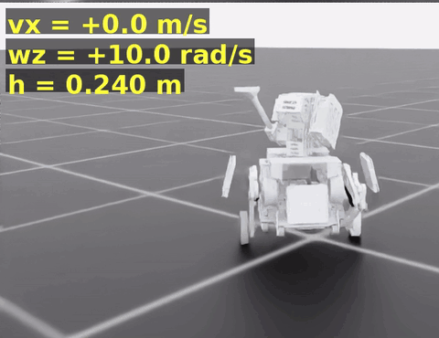
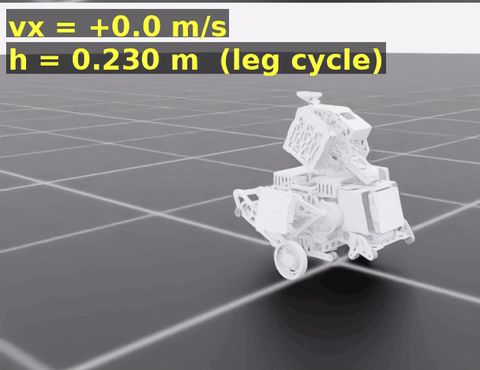
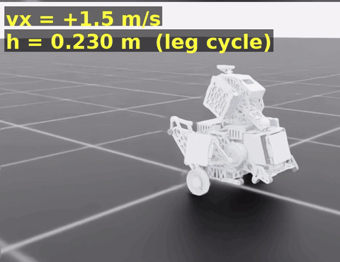
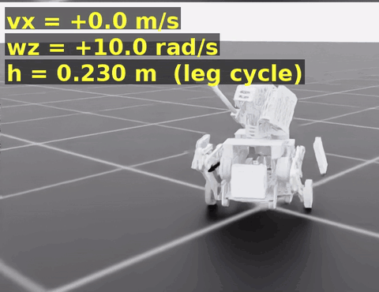
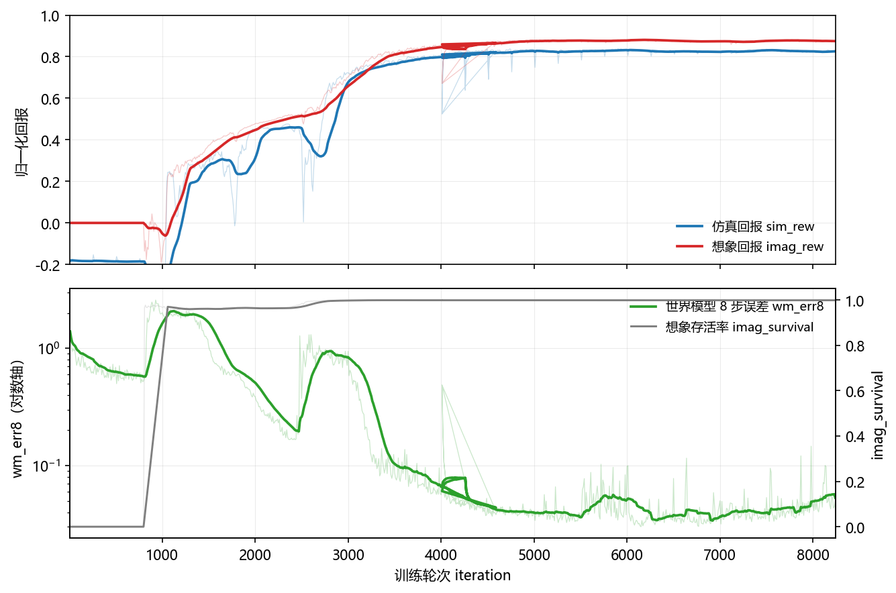

# SuperMimic 轮腿版

把 [SuperMimic](https://github.com/zita-ch/supermimic_vibed) 的训练范式搬到 wheelbipe 轮腿机器人上，训练过程不跑 PPO。

1. 仿真器采 5~15 s 的指令序列进 buffer，正常和失败样本都收；
2. 在这个 buffer 上拟合多步可微世界模型；
3. 在世界模型的想象 rollout 里用 BPTT 同时优化策略和评论家，定期从仿真器刷新 buffer。

非官方移植，与论文作者、`supermimic_vibed`、`wheeled-legged_RL` 均无隶属关系。

| | |
|---|---|
| 前进 | 1.40 m/s（误差 0.01，`wb_c3`），极限 1.50 |
| 原地偏航 | 10.21 rad/s = 1.62 圈/秒，实测 10.3 以上失效 |
| 变腿 | 0.20 - 0.28 m，行程 8 cm |
| 16 条指令评测 | 0 摔倒，归一化回报 0.983 |

<a href="docs/gifs/spin_wz10.gif"></a>

<sub>原地小陀螺 10 rad/s。源视频四格是 7/8/9/10，取右下角那格，2.0 秒实时，没有剪接和变速。</sub>

## 结果

| 原地变腿 | 前进 1.5 m/s + 变腿 | 原地小陀螺 10 rad/s + 变腿 |
|---|---|---|
| <a href="docs/gifs/leg_static.gif"></a> | <a href="docs/gifs/fwd_leg_vx15.gif"></a> | <a href="docs/gifs/spin_leg_wz10.gif"></a> |
| 零速度，腿高按 2 s 周期往复 | 1.5 是极限档，会略微跟不上，可靠上限 1.40 | 边转边变腿，四格里 3/5/7/10 rad/s，取 10 |

四张图都来自同一个检查点 `wb_final`（24000 轮），取四格里参数最大的那一格。



*从零训到 8240 轮（`wb_run1` 的 `train_log.csv`，914 个记录点）。上：仿真回报与想象回报；下：世界模型 8 步预测误差（对数轴）和想象 rollout 存活率。*

## 安装

Linux + RTX（训练），Isaac Sim 5.1 + Isaac Lab 2.3.2，和 `wheeled-legged_RL` 用同一套环境。

机器人只有 USD 资产，没有 URDF，需要自己指定路径：

```bash
export WHEELBIPE_ASSET_ROOT=/path/to/wheeled-legged_RL/source/agent_world/agent_world/assets/usd_files
```

老师权重、`logs/`、生成出来的 mesh 都不在仓库里。老师怎么用见 [docs/upstream.md](docs/upstream.md)。

## 跑

```bash
python tools/selftest_cpu.py            # 30 秒，改奖励或维度后先过这一关
python tools/calibrate.py --headless    # FK 误差应 <= 1e-2 m，弹簧力 ~570 N

python supermimic_wheelbipe/train.py --headless \
  --num_envs 4096 --iterations 24000 --wm_only_iters 800 --warmup_steps 1500 \
  --horizon 16 --compile 0 --utd 2.0 --wm_batches 5 --wm_batch 8192 --pi_batch 4096 \
  --lin_vel_x -1.5 1.5 --ang_vel_z -10.21 10.21 --height_range 0.20 0.28 --log_dir logs/wb_final

python supermimic_wheelbipe/evaluate.py --run_dir logs/wb_final --headless

python tools/play.py --ckpt logs/wb_final/last.pt --commands 1.4,0.0,0.8,0.0 \
  --wzs 0,10.21,6.28,-10.21 --height_cmd 0.24 --enable_cameras --video videos/show.mp4
```

上面这组训练参数在 4090 上跑到 5570 env-step/s，显存 17.8 GB。若从已有检查点续训，加 `--resume`，本仓库那次约 4300 轮 / 43 分钟。

启动时会先静置 120 步测站立高度，`[settle]` 行里倾角 cos < 0.9 说明零动作下机器人会倒，别急着训练。
日志看 `wm_err8`、`imag_survival`、`sim_rew`、`term_frac` 四项。其余参数和录制选项在 [docs/install.md](docs/install.md)。

## 检查点

发布的是推理用检查点，27.7 MB，只含策略网络 `pi`，`tools/play.py` 和 `evaluate.py` 都能直接加载。

```bash
mkdir -p logs/wb_final
curl -fL --retry 3 -o logs/wb_final/pi.pt \
  https://github.com/RadiantForever/supermimic_wheelbipe/releases/download/ckpt-v1/wb_final_pi.pt

sha256sum logs/wb_final/pi.pt    # a08deac15a4b68916c32049b95416da1d44ea9d146ea61f7a398b8c032eab332

python tools/play.py --ckpt logs/wb_final/pi.pt --enable_cameras
```

`logs/` 在 `.gitignore` 里，检查点单独放 Release，不进仓库。

两种检查点别混了：

| 文件 | 大小 | 内容 | 用途 |
|---|---|---|---|
| `wb_final_pi.pt`（Release） | 27.7 MB | 只有 `pi` | 推理、评测、录视频，**不能 `--resume`** |
| `full_ckpt/wb_final_last.pt` | 184 MB | `wm` / `pi` / `critic` / 三个优化器 | `train.py --resume` 续训用，不发布 |

## 已知限制

- 顶速 1.4 - 1.5 m/s，低于上游 2 - 3 m/s 的目标。
- 摩擦力不能逐 env 随机化，PhysX 的 `replicate_physics=True` 下所有 env 共用一个材质。鲁棒性靠弹簧力 ±50 N 和 CoM 抖动。
- 没有 URDF 就没有 IK，重置姿态只能是零动作静置后的姿态，所以 episode 都从稳态高度附近起步。
- 老师只在世界模型前 800 轮混采，且没有做过「完全不给老师」的对照，不能声称不用老师也能到 0.066。
- 轮角不进状态，世界模型只预测轮速。想做轮子相位类任务要改。

## 文档

[docs/install.md](docs/install.md) 标定、训练参数、评测、录制 ·
[docs/upstream.md](docs/upstream.md) 与论文的偏差、老师用法、奖励表

## 许可

代码 MIT。三个 GIF 是本项目自己录的仿真画面。上游归属见 [THIRD_PARTY_NOTICES.md](THIRD_PARTY_NOTICES.md)。

```bibtex
@inproceedings{liao2026supermimic,
  title     = {SuperMimic: Scaling Humanoid Whole-Body Control with One Differentiable World Model},
  author    = {Liao, Qiayuan and Shao, Yuxuan and Long, Junfeng and Zakka, Kevin and Horowitz, Roberto and Abbeel, Pieter and Sreenath, Koushil},
  booktitle = {CoRL},
  year      = {2026},
  note      = {arXiv:2610.28480}
}
```
